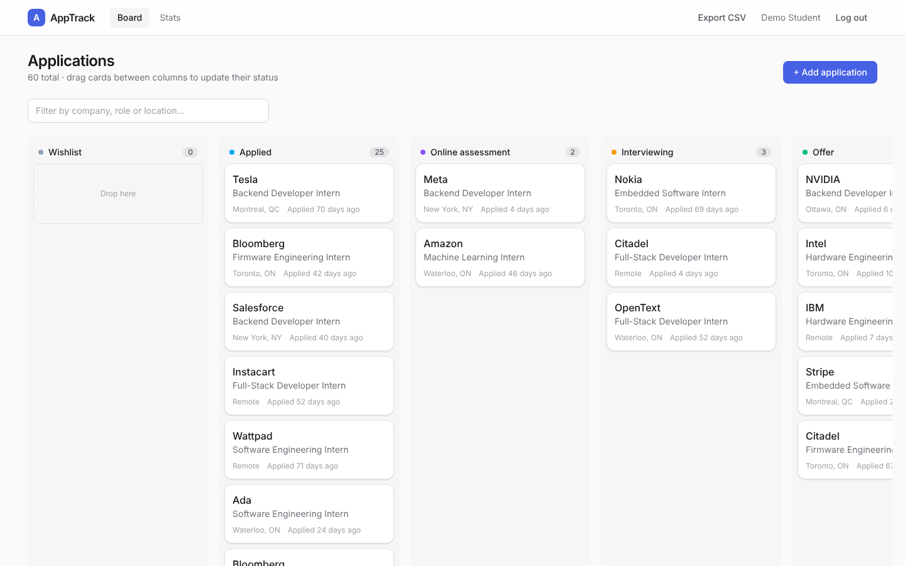
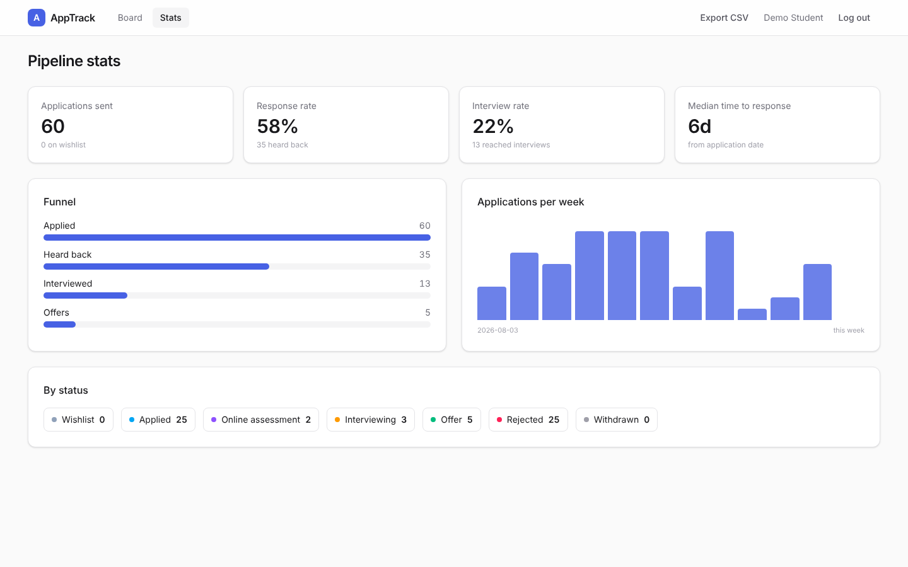
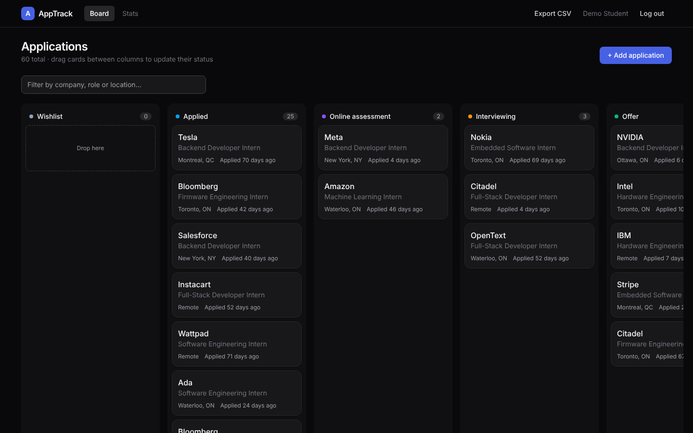

# AppTrack

[](https://github.com/zimroble/apptrack/actions/workflows/ci.yml)

A full-stack app for tracking internship and job applications. You move them
across a drag-and-drop kanban board from *wishlist* to *offer*, and a stats
page shows how your pipeline is converting.

**Stack:** Next.js 15 (App Router, Server Components, Server Actions) · React 19 ·
TypeScript · PostgreSQL · Prisma · Tailwind CSS v4 · Vitest · Playwright · Docker



| Pipeline stats | Dark mode |
|---|---|
|  |  |

## Features

- **Kanban board** with native HTML5 drag-and-drop between and within columns,
  optimistic updates that roll back if the server rejects them, a drop-position
  indicator, and a text filter.
- **Keyboard and touch support.** Every card has a "Move to…" menu, since
  HTML5 drag-and-drop doesn't work on phones.
- **Status history.** Every status change is stored as an event, so the stats
  are computed from what actually happened. An application that reached an
  interview and was later rejected still counts as "interviewed".
- **Pipeline stats:** response rate, interview rate, median days to first
  response, a conversion funnel, and applications per week.
- **CSV export**, RFC 4180 compliant and protected against spreadsheet formula injection.
- **Authentication built from scratch:**
  - bcrypt password hashing (cost 12)
  - random 256-bit session tokens in an `httpOnly`, `SameSite=Lax` cookie
  - only a SHA-256 hash of each token is stored in the database
  - constant-work login, so the response doesn't reveal whether an email exists
- **Per-user data isolation.** Every query is scoped by `userId`, and another
  user's application id returns 404, the same as a missing one. An E2E test
  checks this.

## Design notes

- **Ordering with one write per move.** Cards use fractional positions: a card
  dropped between two neighbours gets the midpoint, so a move updates one row.
  When neighbours get too close (after dozens of drops in the same slot), the
  column is renumbered in a transaction.
- **Server Actions for mutations.** Each action validates input with Zod,
  re-checks ownership of every referenced row (including the neighbour cards
  in a move), and revalidates the affected pages.
- **Derived client state.** The board keeps optimistic local state but adopts
  fresh server data whenever a revalidation arrives, so it can't drift from the
  database.

## Testing

| suite | |
|---|---|
| **18 unit tests** (Vitest) | stats/funnel maths, week bucketing, fractional positions, CSV escaping, validation |
| **14 end-to-end tests** (Playwright, real Postgres) | sign-up/login/logout, wrong-password handling, duplicate emails, `httpOnly` cookie, protected routes; create/edit/delete; drag between columns and reorder within a column (both checked after a reload); filter; **cross-user isolation**; stats and CSV contents; a mobile (Pixel 7) run of the touch "Move to…" flow |

CI runs lint, type-checking, the unit tests, the E2E suite against a Postgres
service container, and a Docker build.

```bash
npm test             # unit
npm run test:e2e     # needs a built app (npm run build) and Postgres; see playwright.config.ts
```

## Performance

`npm run bench` uses autocannon to measure server response times for the
authenticated pages, with a seeded account holding **500 applications**
(`SEED_COUNT=500 npm run db:seed`). Production build, local Postgres, 4-vCPU
cloud VM, 15 s per page:

| page | concurrent connections | req/s | p50 | p90 | p99 |
|---|---:|---:|---:|---:|---:|
| `/board` (500 cards) | 1 | 28 | 34 ms | 42 ms | 52 ms |
| `/stats` | 1 | 60 | 16 ms | 20 ms | 25 ms |
| `/board` (500 cards) | 10 | 33 | 300 ms | 341 ms | 393 ms |
| `/stats` | 10 | 91 | 105 ms | 132 ms | 161 ms |

Rendering only the "Move to…" menu for the card being moved, instead of a
`<select>` on every card, cut the 500-card board's HTML by 26%, from 718 KB to 534 KB.

## Running locally

```bash
cp .env.example .env
docker run -d -p 5432:5432 -e POSTGRES_USER=apptrack -e POSTGRES_PASSWORD=apptrack \
  -e POSTGRES_DB=apptrack postgres:16

npm install
npx prisma migrate deploy
npm run db:seed        # optional demo account: demo@apptrack.dev / demo-password
npm run dev            # http://localhost:3000
```

Or run everything in Docker:

```bash
docker compose up --build    # http://localhost:3000
```

## Deploying

The Docker image runs `prisma migrate deploy` on start and then serves on
`$PORT`, so it works on any container platform with a `DATABASE_URL`, such as
Google Cloud Run with Cloud SQL or Neon, AWS App Runner with RDS, Fly.io or
Render. Session cookies are marked `Secure` in production, so serve the app
over HTTPS.

## Project layout

```
prisma/schema.prisma      User, Session, Application, StatusEvent
prisma/seed.ts            deterministic demo data
src/lib/                  auth, db client, stats, positions, csv, validation
src/app/actions/          server actions (auth, applications)
src/app/                  pages: board, stats, applications/[id], login, signup, api/export, api/health
src/components/           Board (drag-and-drop), forms, app shell
tests/unit, tests/e2e     Vitest and Playwright suites
scripts/bench.mjs         autocannon benchmark
```

## License

MIT
